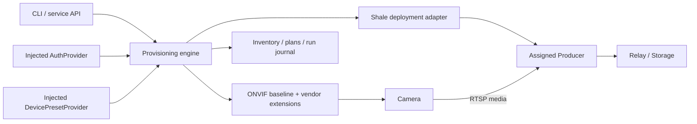

# Camera provisioning as a reusable control-plane module

Status: implemented on the camera-provisioning feature branch, 2026-11-06.
The original code constraints below describe base main `26d8e286`; the new
adapters address them without changing the installed production cameras.

Implementation tracking: [epic #177](https://github.com/lesomnus/shale/issues/177),
with ten new tasks (#178–#187) and the existing ONVIF negotiation task (#128).

The requested scope is discovery, first-time setup when supported, capability
inspection, configuration, and enrollment into Shale. The caller injects an
`AuthProvider`. Factory reset is outside this scope.

For the subsequent CP-authoritative inventory, assignments and job contracts,
see [central camera authority](camera-control-plane.md). The initial local
workflow below remains supported; it does not imply that CP already distributes
credentials or runs dynamic Source consumers.

## Architecture

Extract a reusable provisioning core and device libraries. A CLI, an embedded
application, and a standalone Payday service should call the same core.



The provisioning service carries control messages and qualification results.
Normal recording and viewing continue over camera → Producer → relay/storage.
A bounded media probe runs at the assigned Producer or a worker with equivalent
network access; its result, rather than video, is returned to the controller.

For one camera LAN, controller and worker can be one process. For multiple
VLANs, deploy discovery/operation workers in the relevant networks. A central
service cannot assume that WS-Discovery multicast crosses routers.

## Package boundaries

The reusable packages and process adapters are:

| Package or adapter | Responsibility |
| --- | --- |
| `camera` | Device identity, endpoints, observations, capabilities, driver facets, authentication contracts |
| `camera/discovery` | WS-Discovery and explicitly supplied addresses; observations only |
| `camera/preset` | Scoped, immutable file-backed device preset selection and explicit alternatives |
| `camera/onvif` | Standard device/media operations, with Media2 support |
| `camera/vendors/tplink` | TP-Link first-time activation and model/firmware-specific corrections |
| `camera/media` | Bounded RTSP inspection and decoding; actual codec/FPS/GOP/continuity facts |
| `provision` | Plan, apply, verify, resume and reconcile; injected state/auth/driver/publisher dependencies |
| `internal/provisionhost` | Payday API/CLI hosting, persistence, worker coordination and policy |
| `internal/provisionhost/shale` | Producer deployment and Source binding through Shale contracts |

Public packages allow another Go program to embed the workflow. Keeping all
reusable contracts under `internal/` would prevent direct external reuse. Start
in the existing Go module; a separate module/repository is not required yet.
The core should not depend on CLI formatting, Ent, or generated Shale RPC types.

A manufacturer adapter does not register Shale Sources. It exposes device
operations and normalized evidence; the Shale adapter owns enrollment.

## Device preset injection and adaptation

An embedding application can inject `camera.DevicePresetProvider` through
`provision.Engine.Presets`; the standalone host accepts the same dependency
through `BuildWithOptions`. The default `camera/preset` implementation loads
strict YAML or JSON rules. Requests opt in with `use_preset: true` instead of
supplying direct `desired` settings. Existing direct requests are unchanged.

```go
type DevicePresetProvider interface {
    Resolve(context.Context, EnrollmentScope, DeviceHint) (DevicePreset, error)
}
```

The provider chooses policy; it does not write a camera or supply passwords.
After activation and authenticated inspection, the engine persists the resolved
preset, matched rules and content-derived revision before configuration writes.
Authentication and first-password preparation remain the existing AuthProvider
workflow. MAC matching uses authenticated ONVIF network-interface evidence;
advertised hints do not become ownership or authorization claims.

A preset contains requested device/video settings, required fields and ordered
fallback patches. Zero patch fields inherit the requested setting. An explicit
`preserve` list instead leaves those fields on the device unchanged. Required
fields cannot be changed or preserved by an alternative. Alternatives are
bounded and explicitly configured; an authentication, identity, transport or
uncertain-write failure does not authorize a downgrade.

`DeviceInitializer` plans and applies prerequisites separately from password
activation and video configuration. The C420 implementation sets an explicit
50/60Hz image frequency, reads it back and then refreshes media capabilities
before video planning. A read-only plan reports prerequisite changes without
pretending to know the capabilities after a write it has not performed.

The run keeps `preset.requested`, `effective`, independently `verified` media,
and structured `warnings` separately. A verified alternative reaches `active`
with warnings. The selected candidate and full snapshot survive process restarts
and provider edits. A changed preset is applied through a new request ID, while
the same BindingID keeps the existing logical Source. The API and
`camera status --summary` show the selected preset and adjustments; there is no
camera-provisioning dashboard in the disk-management UI.

See [the standalone provisioner configuration](camera-provisioner.md) for a
scoped ruleset, a C420 frequency prerequisite and a preserve-current fallback.

## AuthProvider injection

The provider selects and supplies credentials. Device drivers implement the
protocol exchange: HTTP Digest, WS-Security, or a manufacturer login handshake.
The provider does not need to reproduce each manufacturer's authentication
protocol.

Illustrative contracts:

```go
type AuthProvider interface {
    Acquire(context.Context, AuthRequest) (CredentialLease, error)
}

type AuthRequest struct {
    Scope       EnrollmentScope
    Device      DeviceHint // includes provenance; identity may still be unverified
    Purpose     AuthPurpose
    Requirement AuthRequirement
    ExistingRef *CredentialRef // resolve this exact credential/version on resume
    IntentKey   string         // stable across retries of credential preparation
}

type CredentialLease interface {
    Ref() CredentialRef
    ExpiresAt() time.Time
    Use(context.Context, func(CredentialMaterial) error) error
    Close() error
}
```

Use distinct purposes for the intended initial administrator credential,
existing management access, and restricted streaming access. Supplying a new
administrator credential for activation is different from authenticating with
an existing password.

- A library caller injects its own provider implementation.
- A standalone service configures a registry of providers. Job requests carry
  an authorized provider/credential reference, not executable callbacks.
- Workers resolve references through their own authenticated provider client.
  A `CredentialLease` callback is a local abstraction, not a wire format.
- Inventory, plans, events, generated configuration and logs contain references
  only. Resolve short-lived material at the driver or Producer boundary.
- A provider may return `NeedsCredentials` or `NeedsUserInput`; persist a waiting
  run and resume it rather than repeatedly trying passwords.

Credential references are stable, versioned and scoped. Reacquiring an
`ExistingRef` must resolve that exact version rather than select a fresh default
credential. `ExpiresAt` and `Close` expire/release access to material, not the
durable credential that was installed on the camera.

For unattended activation, the intended new credential must be recoverable from
the provider **before** it is written to the device. Journal the reference, not
the secret. A crash after changing the camera must not lose its only usable
credential. Future rotation needs both old and new references until new access
is verified; it is not part of the initial implementation.
An interactive/ephemeral provider is useful for inspection, but unattended
activation waits if the intended new credential cannot be recovered after a
process crash or worker change.

Credentials are scoped to an explicitly managed device/network and purpose.
A manufacturer string received over discovery is untrusted evidence, not
sufficient authority to request an administrator secret.

## Device facets and automatic adaptation

Use an ONVIF baseline plus narrowly selected vendor extensions. Avoid a single
manufacturer interface containing discovery, initialization, every setting,
reset and Shale registration.

| Facet | Contract |
| --- | --- |
| `Discoverer` | Produce candidate observations from a discovery scope |
| `Fingerprinter` / `Inspector` | Identify the device, activation state, current configuration and advertised capabilities |
| `Bootstrapper` | Activate a factory-fresh device when a supported initial-setup mechanism exists |
| `VideoConfigurator`, other configurators | Translate normalized changes into supported device operations |
| `MediaVerifier` | Independently inspect the resulting RTSP stream |
| `SourcePublisher` | Deploy to a Producer, bind the resulting Source, and observe readiness |

A registry chooses the baseline and extensions using vendor, model, hardware,
firmware and observed behavior. Resolve one writer per operation; ONVIF and a
vendor extension must not race to configure the same field. Unsupported,
unknown, authentication-required and activation-required are distinct results.

Keep four models separate:

1. **Capabilities:** what an operation or profile can support.
2. **Current state:** what the device reports it is using now.
3. **Desired state:** the caller's policy, including permitted fallbacks.
4. **Verified state:** what read-back and actual media establish.

Record each fact's source, observation time and firmware. Invalidate affected
verification after firmware or profile changes. Do not silently replace a
requested profile with a lower-quality one unless the desired policy permits
that fallback.

The EasyCam C420 is a useful first compatibility case: Media1 reported H.264
while Media2 and the actual stream showed HEVC. Its web login helper also writes
the device clock. A TP-Link extension must correct the former and avoid the
hidden write during inspection. These exceptions belong in the relevant
facets, not scattered through the workflow.

## Workflow and durable execution

```text
Observe → identify candidate → acquire appropriate credentials
  → inspect activation state → activate only if needed
  → authenticate and inspect full identity/capabilities
  → plan desired changes → apply → read back
  → verify actual media from target network
  → deploy capture configuration → bind Source
  → observe ingest/live/committed recording → Active
```

An already configured camera skips activation. An unactivated camera may need
a vendor protocol before ONVIF is available. First-time setup cannot be assumed
to work universally without the necessary device mechanism and credentials.

Persist device and binding identity, desired-state revision, plan/preconditions,
credential references, step outcomes and retry state. Use one in-flight job per
device and idempotent steps. Reinspect after an ambiguous timeout before writing
again. A lease coordinates workers but does not make camera firmware understand
fencing tokens; uncertain old work must settle before another writer proceeds.

There is no atomic transaction covering a camera, a Producer and the CP. Treat
this as a recoverable workflow. Reversible media changes can have compensation;
credential/activation changes require retained recovery access. Failed enrollment
must not delete a Source's existing recordings.

Inspection must be read-only. Tests that move a PTZ motor, play audio or trigger
an alarm are separate operations, not implicit capability checks.

## Identity and Shale enrollment

Separate physical `DeviceID`, mutable network endpoints, camera media profiles,
logical Shale `SourceID`, and `ProducerID`. IP addresses and advertised names are
not device IDs. Combine authenticated identifiers with discovery/certificate/
network evidence; ambiguous identity needs an explicit claim instead of an
automatic merge.

A binding has a stable logical role and target assignment. Rediscovery or DHCP
must not create a new Source. Switching the main profile need not create another
Source either. Physical replacement can deliberately retain a logical Source's
name/history while recording the new device association. Generate aliases once
per binding, not on every retry.
Source aliases are unique across the tenant, while the current Producer lookup
is Set-local. The publisher must handle tenant-wide collisions without adopting
another camera's Source merely because an alias matches.

**Adding a CP Source row alone does not start recording.** Currently:

- `internal/producer/scan.go` mixes host discovery and CLI skeleton output.
- `Producer.Run` joins, waits for Set adoption, registers local configuration's
  Sources, negotiates, then captures (`producer.go:429`, `:540`).
- `Source` stores metadata/profile/Set, not RTSP input or credentials.
- CP derives tenant/site from Set and checks a Producer owns the target Set
  (`server/core/source.go:29`).
- A Source's Set, Tenant and Site are immutable in the current schema.
- Producer has no capture-configuration hot reload/RPC. It also rejects an empty
  Source list before joining (`producer.go:308`).

For the first version, target an existing adopted Producer. The Shale publisher
reserves a stable binding/alias, delivers its complete source specification, and
lets the Producer's existing registration path create or reuse the Source. It
then confirms capture and committed media. Database registration and capture
deployment are separate checkpoints.

An MVP file deployer can atomically update a versioned manifest and gracefully
restart the Producer. Preserve unrelated Sources; fsync both the replacement
file and parent directory. The plan must disclose that this restarts other feeds
on the same Producer. This requires a new credential-reference/resolution
contract: current `SourceConfig.Input` is a string and does not accept a
credential reference. Add a Producer-side resolver or equivalent local runtime
boundary before this deployer is usable; do not resolve secrets into persistent
YAML as a shortcut.

Later add typed desired-configuration delivery, per-source reconciliation and
idle-Producer support. Moving an active binding needs an explicit stop-old/start-
new handoff. Moving it to a Producer in another Set additionally requires a CP
ownership/migration design or a new Source with explicit history association;
current immutable fields do not permit transparent cross-Set SourceID reuse.
That migration is outside the first version.

Tenant/Set/Producer assignment comes from the authenticated enrollment policy,
not discovery data or a vendor adapter. A future publisher service identity needs
explicit scoped authorization; do not impersonate a Producer or bypass its
ownership rules.

## Scope and implementation sequence

1. Extract contracts, WS-Discovery/manual seeds, injected AuthProvider, and an
   ONVIF Media2 inspector. Keep existing CLI behavior through wrappers.
2. Add bounded independent RTSP qualification, sanitized credential handling and
   the Producer/local-runner secret-resolution contract needed by deployment.
   Reuse extracted probe logic rather than the recording runtime itself.
3. Add resumable plan/apply for already activated cameras and idempotent
   deployment/binding to existing Producers. Use fake-device failure injection
   for interruption and retry cases.
4. Add TP-Link first-time activation behind `Bootstrapper`, tested with a
   simulator or a separate genuinely unconfigured device. Do not reset the
   installed production C420 to manufacture a test fixture.
5. Host the core as a standalone Payday service and optional LAN workers; then
   add further manufacturers and desired-configuration/idle-Producer support.

Issue [#128](https://github.com/lesomnus/shale/issues/128) can consume the shared
profile inspector for ONVIF-derived bitrate ceilings and RTSP fallback evidence.
It does not cover this entire provisioning workflow. Provisioning must not become
a mandatory central dependency for every Producer negotiation.

Before real enrollment, replace or redact credential-bearing RTSP URLs in current
capture logs and support credential references at the deployment boundary.
An API response containing a ready stream must not serialize an administrator
password inside its URI.

Factory reset remains excluded. ONVIF defines `SetSystemFactoryDefault`, but
support and authorization must be checked on an actual device; it must never be
an implicit fallback for failed first-time setup or reconciliation. See
[ONVIF Core §8.3.8](https://www.onvif.org/specs/core/ONVIF-Core-Specification.pdf).
